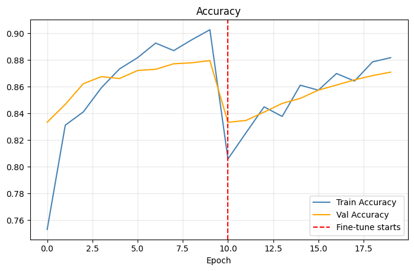
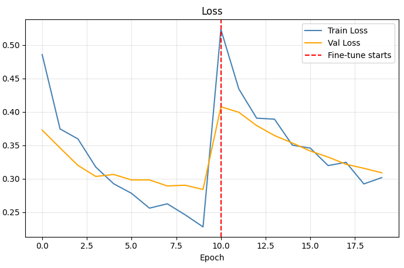
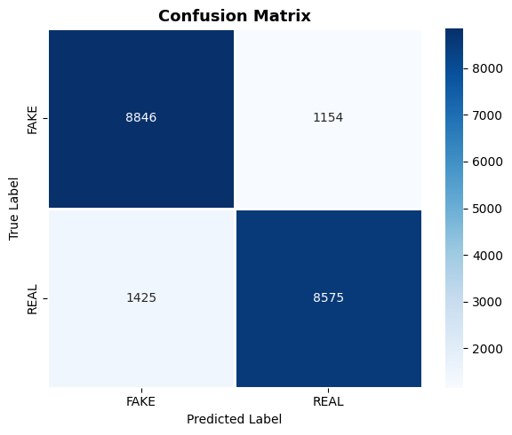
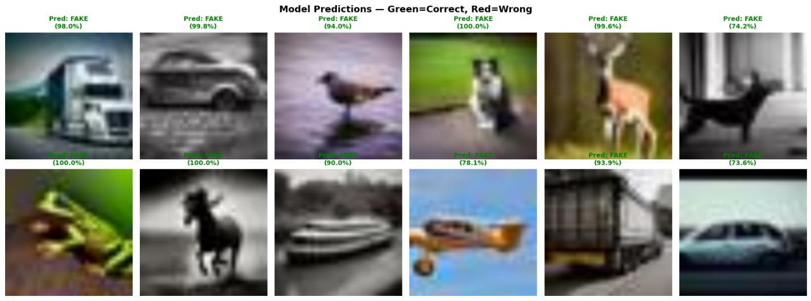

# Fake vs Real Image Detection using Transfer Learning


A deep learning research project applying **Transfer Learning** with Google's **EfficientNet** architecture to detect synthetic AI-generated images (generated by Stable Diffusion / GANs) versus authentic real camera photographs.

Accompanied by complete research documentation: [`Fake_vs_Real_Detection_Documentation.pdf`](Fake_vs_Real_Detection_Documentation.pdf) (MCA S2 — Artificial Intelligence using Gen AI).

---

## 📌 Executive Summary & Problem Formulation

With the exponential growth of Generative Artificial Intelligence—particularly Generative Adversarial Networks (GANs) and Diffusion Models (e.g., Stable Diffusion, Midjourney)—photorealistic synthetic imagery has become indistinguishable from authentic captures to the naked human eye. This poses severe risks in misinformation, digital identity fraud, and media tampering.

This project formulates a robust binary computer vision classification pipeline:
- **`REAL` (Class 1):** Authentic, camera-captured photographic image.
- **`FAKE` (Class 0):** Synthetic image generated by generative diffusion/GAN models.

---

## 📊 Benchmark Dataset — CIFAKE (120,000 Images)

The system is evaluated on the standard **CIFAKE** benchmark dataset:
- **Total Images:** 120,000 balanced RGB images.
  - **60,000 Real:** Natural photographs sampled from the CIFAR-10 benchmark.
  - **60,000 Fake:** Synthetic images synthesized using Stable Diffusion v1.4.
- **Train / Test Partition:** 100,000 training images (50,000 Real, 50,000 Fake) and 20,000 completely unseen test images (10,000 Real, 10,000 Fake).
- **Data Augmentation:** Real-time data pipeline incorporating `RandomFlip`, `RandomRotation(20%)`, `RandomZoom(20%)`, `RandomContrast(20%)`, `RandomBrightness(15%)`, and `RandomTranslation(10%)`.

---

## 🏗️ Neural Network Architecture

```
[Input Layer: 300x300x3 or 224x224x3 RGB]
                  │
[Real-Time Augmentation (Flip, Rotation, Zoom, Contrast, Brightness)]
                  │
[Pretrained EfficientNet Base (ImageNet Weights - Feature Extractor)]
                  │
[Global Average Pooling 2D]
                  │
[Dropout (0.3)]
                  │
[Dense Layer: 128 units, ReLU]
                  │
[Dropout (0.2)]
                  │
[Dense Output Layer: 1 unit, Sigmoid Activation] ──► 0: FAKE | 1: REAL
```

### Why EfficientNet?
EfficientNet utilizes compound scaling (jointly scaling network depth, width, and image resolution) to achieve state-of-the-art accuracy with significantly lower parameter counts (~5.3M parameters for B0, ~12M for B3) compared to ResNet50 (25M) or VGG16 (138M).

---

## ⚙️ Two-Phase Training Strategy

1. **Phase 1 — Feature Extraction (Base Frozen):**
   - The pretrained EfficientNet backbone weights are frozen.
   - The custom classification head is trained for 10 epochs using the **Adam optimizer** ($\eta = 10^{-3}$) and **Binary Cross-Entropy Loss** to establish stable feature representations without destroying pretrained weights.
   - Callbacks: `EarlyStopping(patience=3)` and `ReduceLROnPlateau(factor=0.2, patience=2)`.

2. **Phase 2 — Fine-Tuning (Top Layers Unfrozen):**
   - The top 30–60 convolutional layers of EfficientNet are unfrozen.
   - The network is trained with a significantly reduced learning rate ($\eta = 10^{-5}$, $100\times$ lower) for 15 epochs to adapt high-level feature maps to subtle synthetic diffusion artifacts.
   - Callbacks: `EarlyStopping(monitor='val_accuracy', patience=4, restore_best_weights=True)`.

---

## 📈 Experimental Results & Performance

Evaluated on the full unseen CIFAKE test partition of **20,000 images** (10,000 Real, 10,000 Fake):

- **Overall Test Accuracy:** **87.11%**
- **Test Binary Cross-Entropy Loss:** **0.3088**

### Classification Report

| Class | Precision | Recall | F1-Score | Support |
| :--- | :---: | :---: | :---: | :---: |
| **FAKE** | **0.86** | **0.88** | **0.87** | 10,000 |
| **REAL** | **0.88** | **0.86** | **0.87** | 10,000 |
| **Macro Average** | **0.87** | **0.87** | **0.87** | **20,000** |
| **Weighted Average** | **0.87** | **0.87** | **0.87** | **20,000** |

---

## 🖼️ Visualizations & Screenshots

### 1. Training & Validation Performance Curves
Across both Phase 1 (Feature Extraction) and Phase 2 (Fine-Tuning):

| Training & Validation Accuracy | Training & Validation Loss |
| :---: | :---: |
|  |  |
| *Figure 1: Accuracy progression across epochs* | *Figure 2: Loss reduction across training phases* |

---

### 2. Confusion Matrix
Demonstrates highly balanced classification with minimal false alarms:

<p align="center">
  
</p>

- **True Positives (FAKE correctly identified):** **8,846**
- **True Negatives (REAL correctly identified):** **8,575**
- **False Positives (REAL misclassified as FAKE):** **1,425**
- **False Negatives (FAKE misclassified as REAL):** **1,154**

---

### 3. Sample Model Predictions
Predictions on unseen test samples with classification confidence:

<p align="center">
  
</p>

*(Green titles represent correct classifications; Red titles indicate misclassifications).*

---

## 📁 Repository Structure

```
├── fake_vs_real_detection.py             # Complete training, evaluation & CLI pipeline
├── predict.py                            # Standalone single-image inference script
├── Fake_vs_Real_Image_Detection.ipynb    # Interactive Google Colab / GPU notebook
├── Fake_vs_Real_Detection_Documentation.pdf # Full 10-page formal research report
├── requirements.txt                      # Python dependencies
├── .gitignore                            # Excludes model weights, datasets, and cache
└── screenshots/                          # High-resolution documentation figures
    ├── figure1_training_accuracy.png
    ├── figure2_training_loss.png
    ├── figure3_confusion_matrix.png
    └── figure4_sample_predictions.jpg
```

---

## 🚀 Getting Started

### 1. Clone the Repository
```bash
git clone https://github.com/aashbiii/Fake-vs-Real-Image-Detection.git
cd Fake-vs-Real-Image-Detection
```

### 2. Create Virtual Environment & Install Dependencies
```bash
python -m venv venv
source venv/bin/activate  # On Windows: venv\Scripts\activate
pip install -r requirements.txt
```

### 3. Run Inference on Any Image
Classify any image (real photo or AI-generated):
```bash
python predict.py --image path/to/sample.jpg --model fake_real_detector.h5
```

### 4. Train the Model from Scratch
Download the CIFAKE dataset from Kaggle or extract it into `cifake/` (`train/` and `test/` splits):
```bash
python fake_vs_real_detection.py train --data_dir cifake --epochs_p1 10 --epochs_p2 15
```

### 5. Interactive Notebook
Open `Fake_vs_Real_Image_Detection.ipynb` directly in **Google Colab** or Jupyter Notebook to execute step-by-step with GPU acceleration.

---

## 👤 Author
**Ashbi Saju**  
GitHub: [@aashbiii](https://github.com/aashbiii)  
Course: MCA S2 — Artificial Intelligence using Gen AI
